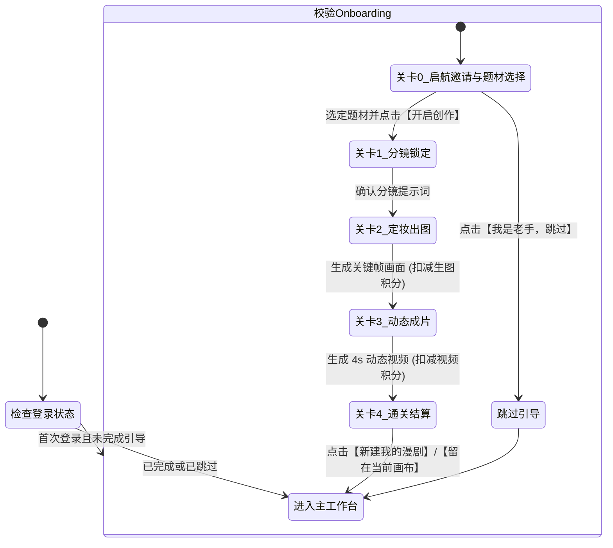
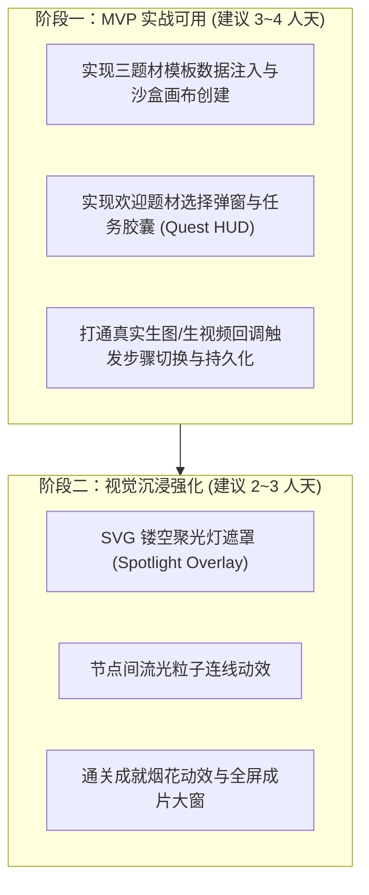

# 万象点点 · 新用户初次登录游戏化新手引导设计方案

> **文档标识**：`DOC-ONBOARDING-20261015`  
> **适用版本**：万象点点 Web / 桌面端  
> **决策确认**：支持“古风修仙 / 都市科幻 / 二次元动画”三选一初始题材；使用用户注册时赠送的基础积分进行实际结算扣减。  
> **核心目标**：指引初次登录用户在 2~3 分钟内亲手完成首条漫剧镜头的“题材选择 → 剧本分镜 → 关键帧生成 → 动态视频运镜 → 成片预览”最小闭环，建立真实的创作掌控感与高光体验。

---

## 目录
1. [背景与核心原则](#一-背景与核心原则)
2. [总体架构与状态流转](#二-总体架构与状态流转)
3. [三选一题材库配置](#三-三选一题材库配置)
4. [四关游戏化主线旅程](#四-四关游戏化主线旅程)
5. [积分结算与扣减体验](#五-积分结算与扣减体验)
6. [前端交互与组件设计](#六-前端交互与组件设计)
7. [数据结构与持久化](#七-数据结构与持久化)
8. [分阶段研发计划](#八-分阶段研发计划)

---

## 一、 背景与核心原则

### 1. 行业现状与设计痛点
- **传统引导弊端**：传统 SaaS 常用的“步骤气泡（Tour Tooltips）”或“静态视频介绍”跳出率高，用户机械式点击“下一步”后依然缺乏亲手创作的信心。
- **漫剧创作门槛**：AI 漫剧包含“提示词构思”、“比例选择”、“模型挑选”、“视频参数调节”等多维概念，新手初次进入空白画布极易产生畏难情绪。

### 2. 核心设计原则
1. **实战沙盒化（Playground First）**：不展示模拟假界面，直接为用户加载专属的《新手导演沙盒》，在真实画布中真实调用模型出片。
2. **题材自主与零摩擦预设（Zero Friction）**：提供 3 种用户最喜爱的爆款题材一键勾选，系统自动注入最优模型（如生图 `gpt-image-2`、视频 `utoooSeedance`）、最佳画幅比例（16:9）与镜头运镜参数。用户全程只需点击 3 次核心操作。
3. **游戏化主线驱动（RPG Questing）**：引入悬浮任务胶囊（Quest HUD）、动态发光连线、关卡达成动效以及通关结算卡，将枯燥的配置转化为“打怪通关”的成就感。
4. **真实商业闭环感知**：直接使用用户注册时赠送的基础积分进行真实核销，让用户第一天就体验到“消耗积分—实时产出影视资产”的完整闭环。
5. **绝对自主可控（Respect the Pro）**：界面右上角时刻保留“跳过引导”选项；在系统设置中支持随时“重温新手引导”。

---

## 二、 总体架构与状态流转



---

## 三、 三选一题材库配置

在启航弹窗中提供 3 张精心打磨的风格卡片供用户单选，默认聚焦推荐第一项：

| 题材分类 | 场景分镜文案预设 | 关键帧提示词（16:9） | 视频运镜推荐 | 推荐模型组合 |
| :--- | :--- | :--- | :--- | :--- |
| **🏯 古风修仙**<br>*(推荐默认)* | *“黑衣刺客雨夜飞掠青瓦，电闪雷鸣撕裂夜空，寒芒出鞘三分，水墨东方电影感。”* | 写实水墨国风，黑衣剑客，雨夜屋脊，拔刀瞬间，电光，电影级景深，冷峻氛围，极致细节 | **急速推进**<br>(4秒) | 生图：`gpt-image-2`<br>视频：`utoooSeedance` 2.0 |
| **🏙️ 都市科幻** | *“霓虹雨夜赛博都市天台，机械义体少女回眸，全息光幕闪烁，赛博朋克电影光影。”* | 赛博朋克都市天台，雨夜，霓虹反光，机械臂少女回眸，全息投影，微光胶片质感，冷暖对比 | **慢速环绕**<br>(4秒) | 生图：`gpt-image-2`<br>视频：`utoooSeedance` 2.0 |
| **🌸 二次元动画** | *“黄昏夕阳下的学院天台，微风吹动校服与发丝，少女伸手触碰落日微光，唯美画风。”* | 新海诚画风，黄昏逆光，唯美二次元少女，校服微风发丝飘动，天台，金色落日，清新通透 | **向上摇移**<br>(4秒) | 生图：`gpt-image-2`<br>视频：`utoooSeedance` 2.0 |

---

## 四、 四关游戏化主线旅程

### 关卡 0：启航令与题材挑选题（The Quest Choice）
- **触发条件**：新注册账号首次登录跳转到 `/home` 时触发。
- **界面呈现**：
  - 全屏黑橙水墨微光蒙版，中央浮现《万象点点 · 新手导演启航》面板。
  - **核心操作区**：陈列【古风修仙】、【都市科幻】、【二次元动画】3 张微缩封面卡片，点击卡片即时呈现微光高亮选中态。
  - **文案**：“欢迎成为万象点点创作者！我们为你备齐了新手实战锦囊。挑选你感兴趣的镜头题材，开启 2 分钟极简出片实战。”
- **交互行动**：
  - **【以所选题材启航】**（橙色主按钮）：自动加载沙盒画布，将所选题材的提示词、模型与参数预填入三节点，进入关卡 1。
  - **【跳过，直接自由创作】**（右上角幽灵按钮）：二次确认后跳过引导，标记已完成，直接回到自由模式。

---

### 关卡 1：点亮故事（分镜剧本锁定）
- **画布初始状态**：
  - 自动进入专属项目 `新手导演训练营`。
  - 画布预置 3 个节点连线：`文本分镜节点` → `关键帧生图节点` → `动态视频节点`。
  - 右上角浮现常驻**任务胶囊（Quest HUD）**：`任务 1/3：锁定故事分镜`。
- **聚光灯与指引**：
  - 镂空遮罩聚焦左侧文本节点，节点内已填充用户选定题材的分镜文案。
  - 气泡提示：“好镜头始于好分镜。确认文案后，点击下方【锁定分镜】。”
- **操作反馈**：
  - 点击后节点泛出水墨辉光，粒子流光顺着连线向生图节点流动，任务胶囊达成打钩。

---

### 关卡 2：唤醒画面（关键帧生成）
- **任务目标**：`任务 2/3：生成关键帧画面`。
- **聚光灯与指引**：
  - 聚焦中央绘图节点，模型已预设最优参数，右侧标注本次消耗积分预估（例如：*预计消耗 3 积分*）。
  - 引导气泡：“分镜已注入！点击【生成首帧】唤醒画面。”
- **真实生成交互**：
  - 点击后向后端发起真实生图任务，节点显示水墨加载动效。
  - 出图成功后画面展开，账户积分实时扣减并弹出轻微浮字反馈（`-3 积分`）。
  - 粒子流光继续向右点亮视频节点通路。

---

### 关卡 3：镜头跃动（图生视频成片）
- **任务目标**：`任务 3/3：让画面动起来`。
- **聚光灯与指引**：
  - 聚焦右侧视频节点，运镜参数已配置所选题材的最优预设，显示视频渲染预估积分（例如：*预计消耗 18 积分*）。
  - 气泡提示：“让定格的瞬间活过来！点击【一键出片】驱动镜头。”
- **真实生成交互**：
  - 点击【一键出片】，发起真实 Seedance 视频生成，任务进度条伴随呼吸波纹推进。
  - 视频生成完毕，钱包积分扣除（`-18 积分`），节点内自动循环无缝播放 4 秒电影级成片。

---

### 关卡 4：通关结算与高光时刻（Level Complete）
- **成片全屏高光**：
  - 视频自动浮起全屏大窗循环播放，伴随微粒庆祝特效。
- **结算卡片（成就看板）**：
  - 🎖️ **获得成就**：`新锐导演 · 镜头初成`
  - 🎬 **作品成果**：支持【一键下载视频 MP4】、【存入个人资产库】。
  - 💰 **积分账户概览**：清晰呈现新手注册赠送总额、本次实战消耗、剩余可用积分（如：*注册赠予 100 积分 - 本次消耗 21 积分 = 剩余 79 积分*），建立真实的商业感知。
- **下一步行动**：
  - **【新建我自己的漫剧】**（跳转正常首页工作区）。
  - **【留在画布自由把玩】**（关闭全屏弹窗，保留当前沙盒自由修改）。

---

## 五、 积分结算与扣减体验

### 1. 真实积分扣减设计
- **注册赠送**：平台新用户注册时，默认由管理员/系统发放基础体验积分（如 100 积分）。
- **实战消耗**：
  - 步骤 2 生图：扣除约 3 积分（按所选模型 16:9 标准尺寸计费）；
  - 步骤 3 图生视频：扣除约 18 积分（按 4 秒视频标准计费）；
  - 全程消耗约 21 积分，新用户仍保有约 79 积分供自由创作。
- **余额不足兜底防护**：
  若新账户因特殊原因未分配到初始积分（余额 < 25 积分），系统在关卡 0 优雅提示：“检测到体验积分正在入账中，点击一键领取新手礼包”或直接自动赠送补齐，绝不允许因欠费阻断新手流程。

---

## 六、 前端交互与组件设计

严格遵循项目前端开发规范（TypeScript + Vue 3 `<script setup>` + Pinia + 小驼峰规范）。

### 1. 新增组件架构规划
```text
apps/web/src/
  stores/
    onboardingStore.ts          # 引导状态、选定题材、当前 step、跳过管理
  components/
    onboarding/
      onboardingWelcome.vue     # 启航令 + 三选一题材卡片弹窗
      onboardingOverlay.vue     # 聚光灯高亮遮罩（基于 SVG mask 镂空高亮定位）
      questHud.vue              # 悬浮任务胶囊（右上角常驻，步骤进度与扣费预览）
      celebrationModal.vue      # 通关成就、视频大屏展示与积分结算总览
```

### 2. DOM 与样式规范约定
- 模板标签统一小驼峰，例如 `<onboardingWelcome />`、`<questHud />`。
- 样式命名一律小驼峰：
  - `.onboardingWelcome`：欢迎与题材挑选面板容器。
  - `.themeCardList` / `.themeCardItem`：三选一卡片列表。
  - `.questHud`：右上角浮动任务胶囊。
  - `.stepProgress`：进度条指示器。
  - `.celebrationModal`：通关弹层容器。

---

## 七、 数据结构与持久化

### 1. 状态定义（`onboardingStore.ts`）
```ts
export type OnboardingTheme = "xianxia" | "cyberpunk" | "anime";

export type OnboardingStep = 
  | "idle"        // 未触发或已结束
  | "welcome"     // 启航邀请与题材选择
  | "promptNode"  // 关卡 1：剧本分镜
  | "imageNode"   // 关卡 2：生图关键帧
  | "videoNode"   // 关卡 3：图生视频
  | "completed";  // 关卡 4：通关结算

export interface OnboardingState {
  currentStep: OnboardingStep;
  selectedTheme: OnboardingTheme;
  hasSkipped: boolean;
  activeSandboxPath?: string;
}
```

### 2. 持久化存储
- 用户首次完成或点击跳过时，调用持久化配置：
  ```ts
  await saveSettings(() => ({ onboardingCompleted: true }));
  ```
- 用户再次登录时通过 `settings.onboardingCompleted` 判定，无需重复弹出。
- 在用户设置菜单中提供入口：
  ```ts
  async function restartOnboarding() {
    await saveSettings(() => ({ onboardingCompleted: false }));
    router.push("/workspace?onboarding=1");
  }
  ```

---

## 八、 分阶段研发计划



---

> **文档交付确认**：  
> 本规范已融入您的两项决策，并沉淀至项目设计文档库。下一步可根据排期正式启动第一阶段（MVP）组件与状态机的代码实现。
