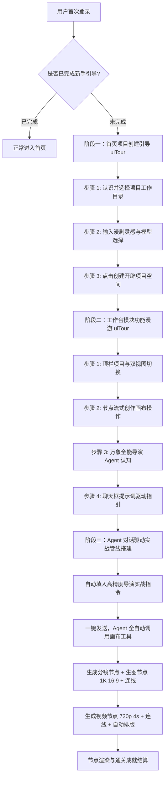

# 万象点点 · 沉浸式聚光灯新手引导（3D 导演台风格）设计方案

> **文档标识**：`DOC-ONBOARDING-V2-20261015`  
> **适用版本**：万象点点 Web / 桌面端  
> **视觉与交互规范**：采用与「3D 导演台」同款的 `@omnistudio-next/ui` `<uiTour />` 步骤聚光灯组件（暗色遮罩 + 亮橙色高亮边框 + 浮动卡片提示 `步骤 1/N`、标题、描述、上一步/下一步/开始实战）。  
> **核心目标**：从首页真实引导用户创建项目工作目录开始，无缝衔接工作台核心模块全景漫游，并最终在 Agent 聊天框中通过精准指令驱动 Agent 全自动创建剧本分镜、生图节点（指定模型 `gpt-image-2` 16:9 1K）、动态视频节点（指定模型 `doubao-seedance-2-0` 720p 4s 运镜）并连线完成样例成品出片。

---

## 一、 整体引导流程与状态设计



---

## 二、 阶段详细交互规范

### 1. 阶段一：首页项目创建引导（`homeTour.vue`）
- **触发条件**：用户初次登录系统，停留于 `/home`，检测到 `settings.onboardingCompleted !== true` 时启动。
- **步骤 1：选择项目工作目录**
  - **聚焦目标**：`.composerFooter`（工作目录选择器）
  - **标题**：“1. 选择项目工作目录”
  - **内容**：“万象点点以工作目录为单元管理画布、分镜与所有生成的素材文件。请首先点击选择或创建一个空文件夹作为你的首个漫剧工作区。”
- **步骤 2：输入漫剧创意灵感**
  - **聚焦目标**：`.composer .promptInput`（输入框与模型区域）
  - **标题**：“2. 输入漫剧创意灵感”
  - **内容**：“在此写下你的故事或题材灵感，下方可挑选驱动创意的文本大模型。系统会自动为你备好初始提示词。”
- **步骤 3：开辟漫剧创作空间**
  - **聚焦目标**：`.composer .sendActions`（发送按钮）
  - **标题**：“3. 开辟漫剧创作空间”
  - **内容**：“选定目录后点击发送按钮，系统将自动在本地/云端创建项目文件夹与空白画布，并直接带你进入核心工作台。”

---

### 2. 阶段二：工作台模块功能漫游（`workspaceTour.vue`）
- **触发条件**：用户进入 `/workspace` 后自动触发，若尚未完成引导则弹起。
- **步骤 1：顶栏导航与双视图**
  - **聚焦目标**：`.workspaceHeader`
  - **标题**：“1. 顶栏导航与双视图”
  - **内容**：“左侧显示当前漫剧项目路径；中间切换器可在「可视节点画布」与「纯文本剧本文档」之间无缝切换，右侧随时可呼出全能 AI 导演助手。”
- **步骤 2：节点流式创作舞台**
  - **聚焦目标**：`.workspaceStage`
  - **标题**：“2. 节点流式创作画布”
  - **内容**：“这是你的核心视觉工作台。文本分镜、关键帧生图、视频生成与运镜控制都在此以节点流形式运转，支持滚轮缩放、中键平移与自由连线编排。”
- **步骤 3：万象全能导演 Agent**
  - **聚焦目标**：`#agentPanel`
  - **标题**：“3. 万象全能导演 Agent”
  - **内容**：“右侧是专属的 AI 导演助手。你可以不用手动拖拽一个个节点，直接在聊天框输入自然语言指令，Agent 能全自动在画布上搭建剧本、节点和生成管线。”
- **步骤 4：提示词驱使 Agent 搭建**
  - **聚焦目标**：`.floatingAgent .messageInput`
  - **标题**：“4. 提示词驱使 Agent 搭建”
  - **内容**：“点击「开始实战」，系统将自动在聊天框填入一条精确到模型（gpt-image-2）、尺寸（16:9 1K）与运镜（doubao-seedance 4s）的实战指令，一键驱动出片！”
  - **完成按钮文案**：`开始实战`（点击后立即关闭 Tour 并将 Agent 面板展开、输入框填入预置指令）。

---

### 3. 阶段三：提示词驱使 Agent 实战搭建与出片
#### 预置标准指令
```text
请帮我搭建《雨夜拔刀》漫剧工作流：
1. 创建【01_剧本分镜】文本节点，填入分镜文案：“黑衣刺客雨夜飞掠青瓦，电闪雷鸣撕裂夜空，寒芒出鞘三分，水墨东方电影感”；
2. 创建【02_画面定妆】生图节点，选择模型 gpt-image-2，设置尺寸 16:9（1K 分辨率），与分镜文本连线；
3. 创建【03_动态漫剧】视频生成节点，选择模型 doubao-seedance-2-0，设置 720p 4 秒时长，运镜设为急速推进，与生图节点连线；
4. 自动在画布上完成排版布局并准备出片。
```

#### 执行与交互
1. 用户点击发送，Agent 接收指令并在右侧输出分步思考；
2. Agent 调用画布核心工具群：
   - `addNode`: 插入 `remote-textNode`（剧本分镜）
   - `addNode`: 插入 `remote-imageGenerationNode`（指定 `model: ["openheapImage", "gpt-image-2"]`, `size: "1K"`, `ratio: "16:9"`）
   - `connectNodes`: 连通文本节点输出至生图节点输入
   - `addNode`: 插入 `remote-videoGenerationNode`（指定 `model: ["utoooSeedance", "doubao-seedance-2-0-260128"]`, `resolution: "720p"`, `duration: 4`, `cameraMotion: "急速推进"`）
   - `connectNodes`: 连通生图节点输出至视频节点输入
   - `arrangeCanvas`: 自动在画布上完成整洁排版
3. 用户在画布上点击生成或 Agent 触发生成，生成首部 4 秒短片样片；
4. 唤起通关成就与实战积分账单弹窗（`celebrationModal.vue`）。

---

## 三、 文件组织与命名

```text
apps/web/src/
  stores/
    onboardingStore.ts          # 引导状态、Tour 步骤流转与标准指令存储
  components/
    onboarding/
      homeTour.vue              # 首页项目目录与灵感创建 Tour
      workspaceTour.vue         # 工作台 3D 导演台风格全景模块 Tour
      celebrationModal.vue      # 通关成就与积分结算弹窗
    settings/panels/general/
      index.vue                 # 提供随时重置引导的入口
```
所有文件、组件和 DOM 选择器均严格遵守小驼峰命名规范。
